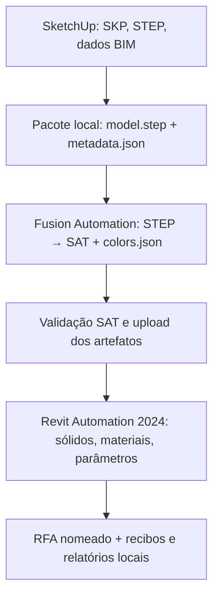

# Arquitetura e contratos do fluxo

[Início](../README.md) · [Dados](DADOS_E_PARAMETROS.md) · [Desenvolvimento](DESENVOLVIMENTO.md)

## Responsabilidades

- **Extensão Ruby:** interface, preferências, proteção do segredo, validação inicial, criação do pacote, autorização APS, upload assinado, publicação dos AppBundles e Activities, acompanhamento, download, recibos e diagnósticos. `cloud_converter.rb` é o cliente de produção; `aps/familybridge.py` é experimental/legado.
- **Fusion worker TypeScript:** abre o STEP; enumera corpos BRep; exige sólidos; registra dimensões e volume por corpo; extrai cor RGB uniforme; exporta SAT e `colors.json`. Não usa o SKP como geometria.
- **Revit worker C#:** abre um template Generic Model, muda a categoria, importa SAT, extrai sólidos e cria `FreeFormElement`. Confere número de corpos e procura correspondência pelo tamanho e volume. Cria materiais RGB e grava parâmetros de família. Salva sob `output_name` e copia para `output.rfa`, contrato de saída do WorkItem.
- **APS:** executa os dois WorkItems em sequência. O primeiro produz `model.sat` e `colors.json`; o segundo recebe esses dois arquivos, `metadata.json` e `template.rft`. O template é obtido por HTTPS de um snapshot público do Revit SDK 2022 e convertido pela execução Revit 2024.

## Identificadores e versões

| Etapa | Engine | AppBundle | Activity |
| --- | --- | --- | --- |
| Conversão STEP | `Autodesk.Fusion+Latest` | `FamilyBridgeStepToSat` | `FamilyBridgeStepToSatActivity` |
| Criação RFA | `Autodesk.Revit+2024` | `FamilyBridgeAutomation2024` | `FamilyBridgeRfa2024` |

O Ruby cria ou versiona os recursos na conta APS e liga o alias configurado à versão resultante. `aps/revit2024/activity.template.json` é uma **referência**, não o arquivo que o Ruby lê em tempo de execução. Alterações de parâmetros exigem atualizar os dois lugares e os testes.

## Correspondência e integridade

O Fusion grava `schema_version: 1`, uma entrada por corpo sólido, dimensões em milímetros, volume em mm³ e RGB. O Revit compara cada sólido importado com as entradas do manifesto, com tolerância implementada no worker (dimensões até 1 mm e volume relativo até 2%). Contagens divergentes, falta de cor ou pares indistinguíveis que tenham cores distintas provocam falha, evitando atribuir uma cor arbitrária. Isso não equivale à preservação de identidade topológica em qualquer STEP.

O cliente interrompe antes do segundo WorkItem se o SAT ASCII emitido indicar versão ACIS maior que 7. Os arquivos `aps-job.json` e `aps-revit-job.json` registram IDs e estado sem tokens/URLs assinadas; sua presença impede reutilização acidental da pasta. Um timeout de interface ou erro de rede depois do POST não prova que o job remoto não começou. Verifique o ID e o estado remoto antes de qualquer novo envio.

## Fronteira de confiança

Client Secret e token permanecem no cliente SketchUp e são usados para autenticação APS. O segredo pode ser guardado por DPAPI no Windows, nunca dentro do pacote exportado. Relatórios são sanitizados antes de gravar, mas inspecione manualmente qualquer arquivo antes de publicar. SKP, STEP, parâmetros e RFA podem conter informações proprietárias do produto.

## Limites conhecidos

O RFA 2024 não abre no Revit 2022. Os sólidos não têm histórico paramétrico CAD, conectores MEP ou materiais físicos/texturas equivalentes aos do STEP. Uma cor uniforme por corpo é exigida. A execução real do novo caminho de cor ainda está pendente; os testes de rede são simulados e não substituem uma inspeção do RFA gerado na conta APS.
