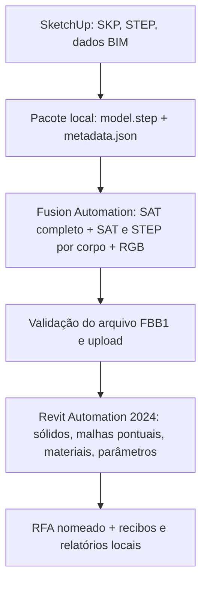

# Arquitetura e contratos do fluxo

[Início](../README.md) · [Dados](DADOS_E_PARAMETROS.md) · [Desenvolvimento](DESENVOLVIMENTO.md)

## Responsabilidades

- **Extensão Ruby:** interface, preferências, proteção do segredo, validação inicial, criação do pacote, autorização APS, upload assinado, publicação dos AppBundles e Activities, acompanhamento, download, recibos e diagnósticos. `cloud_converter.rb` é o cliente de produção; `aps/familybridge.py` é experimental/legado.
- **Fusion worker TypeScript:** abre o STEP; enumera corpos BRep; exige sólidos; registra dimensões e volume por corpo; extrai cor RGB uniforme; exporta o SAT completo para diagnóstico, um SAT por corpo em `bodies.fbdat`, um STEP por corpo em `steps.fbdat` e `colors.json` na mesma ordem. Não usa o SKP como geometria.
- **Revit worker C#:** abre um template Generic Model, muda a categoria, importa cada SAT individualmente, tenta o STEP correspondente e `ShapeImporter` quando necessário. Se nenhum produzir um sólido, reconstrói apenas aquele corpo como malha `DirectShape`, com RGB. Confere posição, dimensões e volume antes de criar a geometria. Cria materiais RGB e grava parâmetros de família. Salva sob `output_name` e copia para `output.rfa`, contrato de saída do WorkItem.
- **APS:** executa os dois WorkItems em sequência. O primeiro produz `model.sat`, `colors.json`, `bodies.fbdat` e `steps.fbdat`; o segundo recebe `bodies.fbdat`, `steps.fbdat`, `colors.json`, `metadata.json` e `template.rft`. O template é obtido por HTTPS de um snapshot público do Revit SDK 2022 e convertido pela execução Revit 2024.

## Identificadores e versões

| Etapa | Engine | AppBundle | Activity |
| --- | --- | --- | --- |
| Conversão STEP | `Autodesk.Fusion+Latest` | `FamilyBridgeStepToSat` | `FamilyBridgeStepToSatActivity` |
| Criação RFA | `Autodesk.Revit+2024` | `FamilyBridgeAutomation2024` | `FamilyBridgeRfa2024` |

O Ruby cria ou versiona os recursos na conta APS e liga o alias configurado à versão resultante. `aps/revit2024/activity.template.json` é uma **referência**, não o arquivo que o Ruby lê em tempo de execução. Alterações de parâmetros exigem atualizar os dois lugares e os testes.

## Correspondência e integridade

O Fusion grava `schema_version: 1`, uma entrada por corpo sólido, limites e dimensões em milímetros, volume em mm³ e RGB. O arquivo `bodies.fbdat` usa formato binário FBB1: quatro bytes ASCII `FBB1`, quantidade de corpos UInt32 little endian, seguida de [comprimento UInt32 little endian, bytes SAT] para cada entrada. A ordem é idêntica à do manifesto; não há nomes de arquivo nem caminhos no arquivo. O Ruby confere versão SAT e quantidade antes de enviar ao Revit. O arquivo `steps.fbdat` usa o mesmo layout, com assinatura `FBS1` e bytes STEP por corpo. O Revit tenta SAT, STEP e `ShapeImporter`; quando todos falham como sólido, aceita uma malha individual `DirectShape` depois de validar volume e dimensões; confere dimensões e orientação no sistema global (desvio inferior a 5 mm, aplicando `BoundingBoxXYZ.Transform`) e volume (diferença relativa inferior a 2%). Depois reposiciona o sólido pelo centro da caixa e atribui o RGB da entrada correspondente. Divergências de cada corpo são registradas antes de interromper o job. Dois produtos reais concluíram o WorkItem na APS; a análise geométrica e os limites dessa confirmação estão em [Validação](VALIDACAO_APS.md).

O cliente interrompe antes do segundo WorkItem se algum SAT individual indicar versão ACIS incompatível, se o FBB1 ou FBS1 exceder 100 MB ou se o STEP não tiver cabeçalho ISO válido. Os arquivos `aps-job.json` e `aps-revit-job.json` registram IDs e estado sem tokens/URLs assinadas; sua presença impede reutilização acidental da pasta. Um timeout de interface ou erro de rede depois do POST não prova que o job remoto não começou. Verifique o ID e o estado remoto antes de qualquer novo envio.

## Fronteira de confiança

Client Secret e token permanecem no cliente SketchUp e são usados para autenticação APS. O segredo pode ser guardado por DPAPI no Windows, nunca dentro do pacote exportado. Relatórios são sanitizados antes de gravar, mas inspecione manualmente qualquer arquivo antes de publicar. SKP, STEP, parâmetros e RFA podem conter informações proprietárias do produto.

## Limites conhecidos

O RFA 2024 não abre no Revit 2022. A geometria não tem histórico paramétrico CAD, conectores MEP ou materiais físicos/texturas equivalentes aos do STEP. Um corpo que vira malha continua sem faces sólidas nativas no Revit. Uma cor uniforme por corpo é exigida. A execução real do novo caminho de cor ainda está pendente; os testes de rede são simulados e não substituem uma inspeção do RFA gerado na conta APS.
